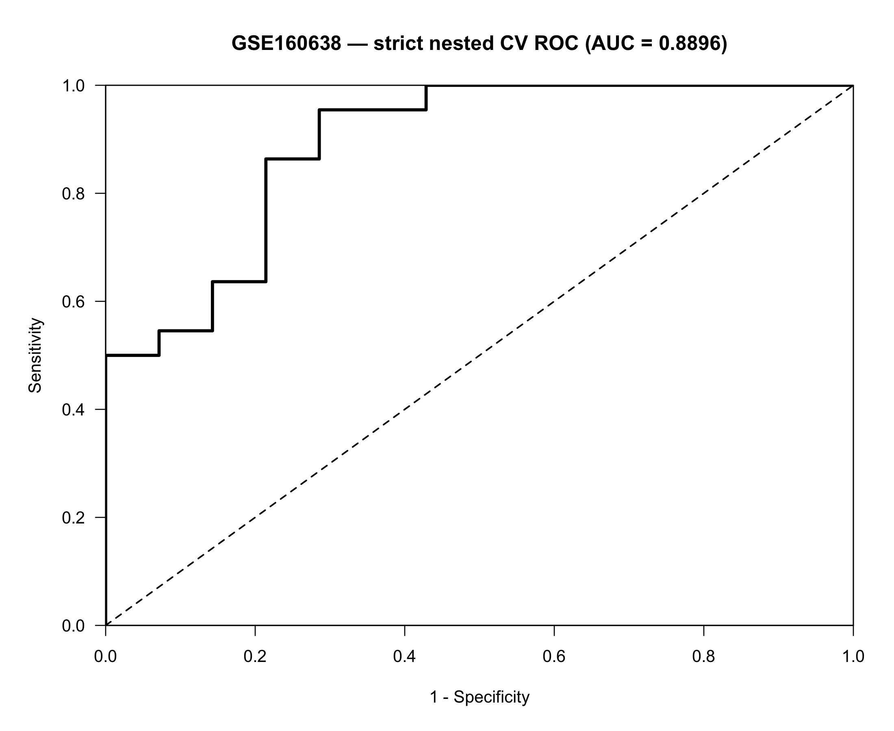
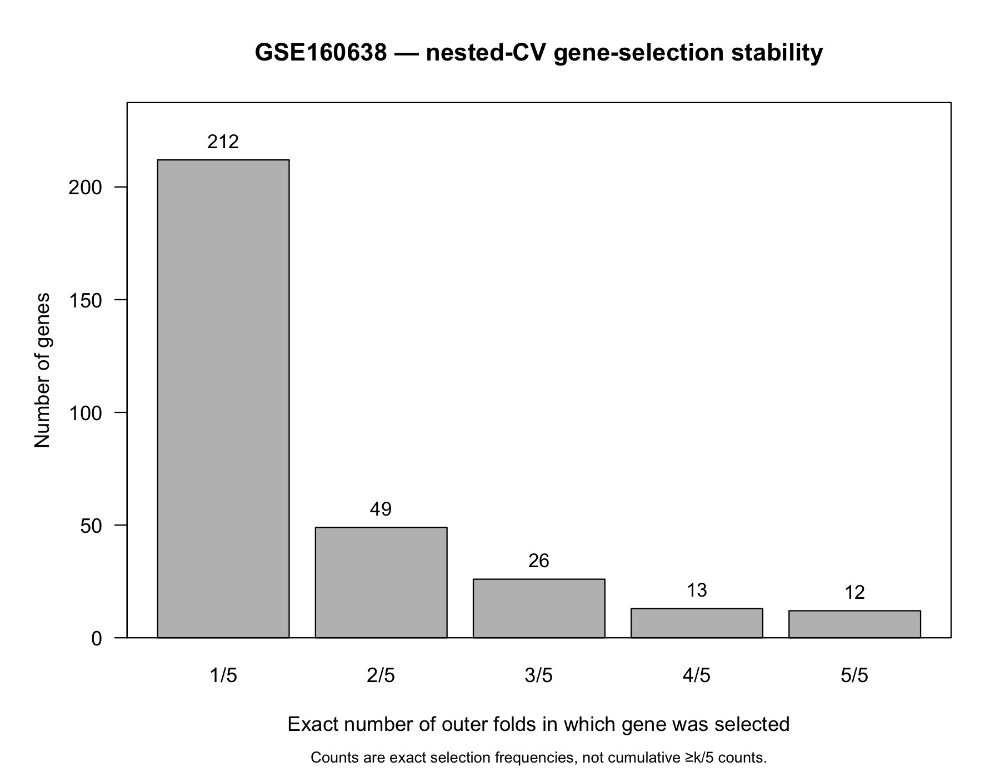
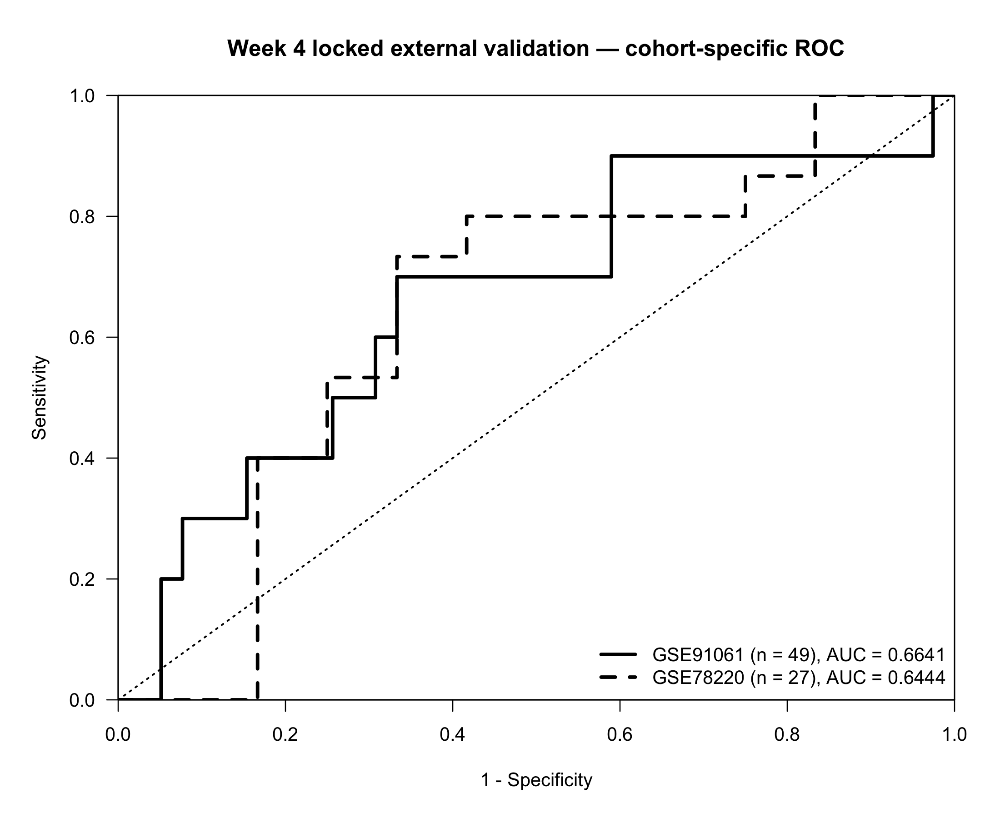
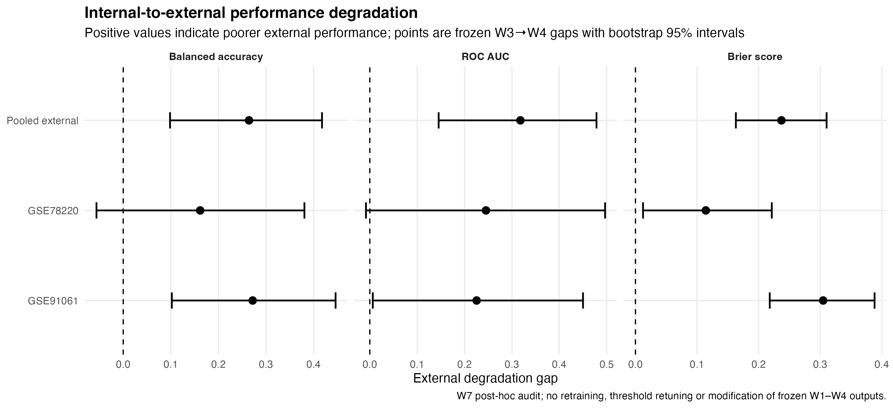

# Melanoma immunotherapy response — reproducible bioinformatics pipeline

[](https://github.com/joancarrerasdz/melanoma-immunotherapy-response-pipeline/actions/workflows/repository-qa.yml)

A reproducible transcriptomic machine-learning workflow for evaluating anti-PD-1 treatment response in melanoma.

**Current release:** [`v1.0.1`](https://github.com/joancarrerasdz/melanoma-immunotherapy-response-pipeline/releases/tag/v1.0.1)<br>
**Analytical baseline:** [`v1.0.0`](https://github.com/joancarrerasdz/melanoma-immunotherapy-response-pipeline/releases/tag/v1.0.0)<br>
**Status:** Reproducibility-certified portfolio release<br>
**Final certification:** W8 end-to-end clean-room reproduction — **PASS**

This repository reconstructs and extends an original MSc thesis analysis under a stricter methodological framework focused on:

- traceable clinical endpoint reconstruction;
- leakage-aware preprocessing;
- nested cross-validation;
- feature-selection stability;
- frozen model specification;
- blind external prediction;
- locked external validation;
- evaluation uncertainty;
- external transportability;
- reproducible computing environments;
- canonical artifact verification;
- explicit methodological QA gates.

The complete Week 1–8 methodological rebuild is preserved as analytical baseline `v1.0.0`.

Release `v1.0.1` adds the final QA documentation for the canonical data dictionary (U03) and strict 12-gene biological interpretation (P1-11), without changing the frozen analytical results.

The original academic repository state is preserved at tag `tfm-original`.

---

## Project snapshot

| Item | Current reproducible pipeline |
|---|---|
| **Clinical question** | Pre-treatment transcriptomic modelling of anti-PD-1 response in melanoma |
| **Development cohort** | GSE160638 — 36 patients, 17,002 validated expression features |
| **Internal validation** | 5 × 3 nested cross-validation with training-only feature selection and tuning |
| **Internal performance** | AUC = **0.8896** from pooled outer out-of-fold predictions |
| **Stable candidate set** | 12 genes selected in all 5 outer folds |
| **External validation** | Locked cohort-specific evaluation on GSE91061 (n = 49) and GSE78220 (n = 27) |
| **External performance** | GSE91061 AUC = **0.6641**; GSE78220 AUC = **0.6444** |
| **Transportability** | External performance is materially lower and more uncertain than internal performance |
| **Reproducibility** | `renv`, automated repository QA, canonical SHA-256 manifest and clean-room end-to-end certification |
| **Release** | `v1.0.1` — analytical baseline `v1.0.0` |

> **Interpretation boundary:** the AUC of 0.8896 is an **internal nested-cross-validation estimate**. External performance is reported separately and is more modest and cohort-dependent. The 12-gene set is a stability-derived candidate set, not a clinically validated biomarker.

---

## Project overview

### Development cohort

**GSE160638**

- 36 anti-PD-1 melanoma samples;
- 22 Responders;
- 14 NonResponders;
- 17,002 validated expression features.

The clinical treatment-response endpoint is reconstructed from the official supplementary clinical Table S2A.

Response mapping:

- `CR` / `PR` → `Responder`
- `SD` / `PD` → `NonResponder`

Full data provenance is documented in [`DATA.md`](DATA.md).

### External cohorts

The frozen deployment procedure is evaluated independently on:

- **GSE91061:** 49 pre-treatment samples;
- **GSE78220:** 27 pre-treatment samples.

External response labels are not used to redefine the gene set, expression representation, model, hyperparameters or classification threshold.

---

## Methodological workflow

```text
Validated raw counts + clinical endpoint
                |
                v
Week 2 exploratory preprocessing
(descriptive / exploratory only)
                |
                v
Week 3 strict nested cross-validation
                |
                +--> predictive preprocessing from training data
                |
                +--> feature selection inside resampling
                |
                +--> hyperparameter tuning inside training data
                |
                v
Outer out-of-fold validation
                |
                v
Post-validation gene-stability analysis
                |
                v
Frozen 12-gene consensus candidate set
                |
                v
Week 4 label-free representation audit
                |
                v
Frozen samplewise_rank representation
                |
                v
Frozen model + blind external predictions
                |
                v
External outcome unblinding
                |
                v
Locked external evaluation
                |
                v
Week 7 uncertainty + transportability audit
                |
                v
Week 8 canonical artifact verification
                |
                v
Fresh-clone environment restoration
                |
                v
End-to-end clean-room reproduction
                |
                v
v1.0.0 reproducibility-certified release
```

The formal preprocessing boundary is documented in [`docs/preprocessing_contract.md`](docs/preprocessing_contract.md).

---

## Week 3 — strict internal validation

Week 3 uses nested cross-validation to separate model development from outer-fold performance estimation.

The strict workflow uses:

- 5 outer folds;
- 3 inner folds;
- feature selection restricted to training partitions;
- hyperparameter tuning restricted to training partitions;
- one outer out-of-fold prediction per sample.

### Internal nested-CV performance

| Metric | Value |
|---|---:|
| Accuracy | 0.8333 |
| Sensitivity | 0.9091 |
| Specificity | 0.7143 |
| Balanced Accuracy | 0.8117 |
| AUC | 0.8896 |

These values are **internal nested-cross-validation estimates**.

They are not external-validation performance estimates.



*Figure 1. Strict Week 3 nested-cross-validation ROC based on pooled outer out-of-fold predictions. The reported AUC is an internal validation estimate, not external-validation performance.*

### Feature-selection stability

| Selection frequency | Genes |
|---|---:|
| ≥1/5 outer folds | 312 |
| ≥2/5 outer folds | 100 |
| ≥3/5 outer folds | 51 |
| ≥4/5 outer folds | 25 |
| 5/5 outer folds | 12 |



*Figure 2. Feature-selection stability across the five strict outer cross-validation folds. Twelve genes were selected in all five outer training partitions.*

The 12 genes selected in all five outer folds are treated as **stability-derived consensus candidates**.

They are not described as a clinically validated molecular signature.

See [`docs/week3_historical_vs_strict_stability_audit.md`](docs/week3_historical_vs_strict_stability_audit.md).

---

## Week 4 — locked external validation

Week 4 evaluates a frozen deployment procedure on two independent cohorts.

The locked specification uses:

- the 12 Week 3 consensus candidates;
- `samplewise_rank` representation;
- Random Forest;
- `mtry = 1`;
- 500 trees;
- classification threshold `0.48`.

The deployment model and all 76 blind external predictions were frozen before external response labels were opened.

Blind-prediction freeze commit:

`3e427be1b885b9514cb8acc857e3eb3ca90e4ceb`

### Primary cohort-specific results

| Dataset | n | AUC | Accuracy | Sensitivity | Specificity | Balanced Accuracy |
|---|---:|---:|---:|---:|---:|---:|
| GSE91061 | 49 | 0.6641 | 0.3265 | 0.9000 | 0.1795 | 0.5397 |
| GSE78220 | 27 | 0.6444 | 0.6667 | 0.8000 | 0.5000 | 0.6500 |

Dataset-specific results are the primary external-validation assessment.



*Figure 3. Locked external-validation ROC results for the two independent external cohorts. Model specification, representation, hyperparameters and classification threshold were frozen before external outcome unblinding.*

### Secondary pooled summary

| Metric | Value |
|---|---:|
| AUC | 0.5718 |
| Accuracy | 0.4474 |
| Sensitivity | 0.8400 |
| Specificity | 0.2549 |
| Balanced Accuracy | 0.5475 |

The pooled result is retained only as a **secondary descriptive summary** because the two external cohorts differ in prevalence and composition.

Detailed methodology is documented in [`docs/week4_locked_external_validation.md`](docs/week4_locked_external_validation.md).

---

## Week 7 — evaluation uncertainty and external transportability

Week 7 performs a post-hoc audit of the already frozen Week 3 and Week 4 results.

No retraining, gene reselection, representation change, threshold retuning or modification of frozen analytical outputs is performed.

The audit evaluates:

- uncertainty around internal and external performance;
- outer-fold variability;
- reference-level comparison against no-skill performance;
- degradation from internal to external evaluation;
- uncertainty around the observed degradation.

### Internal-to-external degradation

| Metric | Internal estimate | Pooled external estimate | Degradation gap | 95% bootstrap CI |
|---|---:|---:|---:|---:|
| Balanced Accuracy | 0.8117 | 0.5475 | **0.2642** | **[0.0983, 0.4176]** |
| AUC | 0.8896 | 0.5718 | **0.3178** | **[0.1453, 0.4785]** |
| Brier score | 0.1293 | 0.3664 | **0.2371** | **[0.1631, 0.3104]** |

For discrimination metrics, positive degradation indicates poorer external performance.

For Brier score, positive degradation indicates worse external probability quality because lower values are preferable.



*Figure 4. Frozen Week 3-to-Week 4 performance degradation with bootstrap 95% intervals. The audit quantifies transportability uncertainty without modifying the previously frozen model or predictions.*

### Cohort-specific interpretation

For **GSE91061**, degradation is supported for:

- Balanced Accuracy;
- AUC;
- Brier score.

For **GSE78220**, Brier-score degradation is supported, whereas the bootstrap intervals for Balanced Accuracy and AUC include zero.

The pooled external comparison shows supported degradation for all three principal metrics.

### Methodological conclusion

The final model shows strong internal discrimination but substantially weaker and more uncertain external performance.

The principal limitation identified by the reproducible evaluation is therefore **external transportability**, rather than failure to fit the development cohort.

This distinction is preserved explicitly rather than optimized away after external outcome unblinding.

---

## Week 8 — final reproducibility certification

Week 8 converts the completed analytical workflow into a release-level reproducibility contract.

It does not introduce a new predictive model or reinterpret the frozen Week 3–4 analytical results.

Instead, W8 verifies that the project can be reconstructed and executed from a fresh environment while preserving the certified analytical artifacts.

### Canonical artifact baseline

A canonical manifest records the release artifacts and their SHA-256 hashes.

Key release files include:

- `results/w8_canonical_artifact_manifest.csv`
- `results/w8_canonical_artifact_manifest.sha256`
- `results/w8_release_baseline.csv`
- `docs/w8_release_contract.md`

The canonical manifest contains **222 certified artifact records**.

### Clean-room certification

The final isolated fresh-clone certification produced:

| Certification gate | Result |
|---|---:|
| Fresh-clone repository state | **PASS** |
| `renv` environment restoration | **PASS** |
| Dependency contract | **PASS** |
| Pre-run canonical hashes | **222 / 222 PASS** |
| Full W1–W4 reproducible pipeline | **PASS** |
| Pipeline completion signal | **PASS** |
| Post-run canonical hashes | **222 / 222 PASS** |
| Deterministic Week 2 PCA rendering | **PASS** |
| Repository worktree integrity | **PASS** |
| Post-run `renv` synchronization | **PASS** |
| Git HEAD immutability | **PASS** |

Final certification:

```text
W8.2D.3 END-TO-END CLEAN-ROOM CERTIFICATION: PASS
```

This certification demonstrates that the canonical analytical workflow can be regenerated from a fresh clone under the recorded dependency environment without altering the certified repository state.

---

## Interpretation

The reconstructed analysis shows an important distinction between **internal predictive signal** and **external transportability**.

The internal nested-CV AUC is:

`0.8896`

The two independent external-cohort AUCs are:

- GSE91061: `0.6641`
- GSE78220: `0.6444`

The pooled external AUC is:

`0.5718`

The W7 bootstrap audit estimates an internal-to-pooled-external AUC degradation of:

`0.3178 [95% CI: 0.1453, 0.4785]`

Accordingly:

- Week 3 performance is reported as internal nested-CV performance;
- external validation is reported primarily by cohort;
- the pooled external estimate remains secondary;
- uncertainty around transportability is reported explicitly;
- the 12-gene set remains a stability-derived deployment candidate;
- no claim of clinical biomarker validation is made.

The difference between internal and external performance is preserved rather than optimized away after external unblinding.

---

## Leakage safeguards

Predictive preprocessing, feature selection and tuning are restricted to training data during model development.

After external unblinding, the workflow explicitly prohibits:

- gene reselection;
- expression-representation changes;
- model refitting;
- hyperparameter retuning;
- classification-threshold changes;
- threshold optimization against external outcomes.

Weeks 7 and 8 are audit and reproducibility phases. They do not modify the frozen Week 3–4 analytical outputs.

---

## Confounding and cohort heterogeneity

Clinical and methodological heterogeneity were formally assessed during QA remediation.

The assessment covers:

- response-class composition;
- age;
- gender;
- BRAF mutation;
- LDH;
- biopsy heterogeneity;
- technical batch-metadata availability;
- residual confounding;
- external cohort effects.

No validated technical batch variable was available in the project metadata.

This limitation is documented explicitly and is not interpreted as evidence that batch effects are absent.

See [`docs/confounding_assessment.md`](docs/confounding_assessment.md).

---

## Reproducibility

The complete portfolio workflow uses a project-level reproducible R environment together with release-level artifact verification.

Key files:

- `renv.lock`
- `DESCRIPTION`
- `.Rprofile`
- `renv/`
- [`docs/reproducible_environment.md`](docs/reproducible_environment.md)
- [`docs/w8_release_contract.md`](docs/w8_release_contract.md)

### Core analytical environment

The frozen analytical environment includes:

| Component | Version |
|---|---:|
| edgeR | 4.6.3 |
| caret | 7.0.1 |
| randomForest | 4.7.1.2 |
| pROC | 1.19.0.1 |
| rlang | 1.3.0 |
| httr2 | 1.3.0 |

Use the R version recorded by the project dependency environment.

### Restore

From the repository root:

```bash
Rscript -e 'renv::restore(prompt = FALSE)'
```

A synchronized restore should complete with the project dependency state consistent with `renv.lock`.

### Execute the complete reproducible pipeline

```bash
Rscript scripts/run_pipeline.R
```

The pipeline executes the certified Week 1–4 workflow.

Individual stages remain available as:

```bash
Rscript scripts/run_week1.R
Rscript scripts/run_week2.R
Rscript scripts/run_week3.R
Rscript scripts/run_week4.R
```

A successful pipeline reproduction terminates with a PASS completion signal.

### Release verification

The W8 release process additionally verifies the regenerated canonical artifacts against the SHA-256 manifest.

The final release certification was performed from a fresh isolated clone rather than from the development working directory.

---

## Quality assurance

The repository uses two complementary QA layers.

### Methodological remediation QA

Three formal remediation gates were introduced after the portfolio QA review without changing the previously frozen Week 3 or Week 4 analytical results.

| QA gate | Result |
|---|---:|
| U08 / P1-04 preprocessing contract | 35 PASS / 0 FAIL |
| U11 reproducible environment | 37 PASS / 0 FAIL |
| U07 / P1-10 confounding assessment | 15 PASS / 0 FAIL |
| **Consolidated methodological remediation** | **87 PASS / 0 FAIL** |

The remediation did not:

- reselect genes;
- change preprocessing retrospectively;
- alter nested cross-validation;
- change the frozen 12-gene set;
- modify `samplewise_rank`;
- refit the Week 4 model;
- retune `mtry`;
- change the classification threshold;
- recompute blind predictions using response labels.

The completed remediation is preserved at tag:

`qa-remediation-w3-w4-complete`

### Release reproducibility QA

W8 adds a separate release-level layer covering:

- canonical artifact hashing;
- clean-room clone validation;
- dependency restoration;
- deterministic figure generation;
- full pipeline execution;
- post-run artifact verification;
- repository cleanliness;
- HEAD immutability.

The final W8 certification status is:

**PASS**

---

## Repository structure

```text
.
├── .github/
│   └── workflows/        # Automated repository QA
├── data_raw/             # Public source data
├── data_processed/       # Validated and derived analytical objects
├── scripts/              # Analysis, reproduction and QA scripts
├── results/              # Analytical outputs, audits and release manifests
├── figures/              # Generated figures
├── docs/                 # Methodological, audit and release documentation
├── renv/                 # Reproducible environment infrastructure
├── DATA.md               # Data provenance and analytical contract
├── DESCRIPTION           # R dependency contract
├── renv.lock             # Reproducible environment snapshot
├── CITATION.cff          # Repository citation metadata
├── NOTICE.md             # Third-party data and licensing boundary
├── LICENSE               # MIT license for project-authored code
└── README.md
```

---

## Key documentation

- [`DATA.md`](DATA.md) — data provenance and endpoint reconstruction
- [`docs/public_artifact_manifest.md`](docs/public_artifact_manifest.md) — canonical, supporting, exploratory and historical artifact classification
- [`docs/preprocessing_contract.md`](docs/preprocessing_contract.md) — preprocessing boundaries
- [`docs/reproducible_environment.md`](docs/reproducible_environment.md) — reproducible environment
- [`docs/confounding_assessment.md`](docs/confounding_assessment.md) — confounding and cohort heterogeneity
- [`docs/week3_historical_vs_strict_stability_audit.md`](docs/week3_historical_vs_strict_stability_audit.md) — historical versus strict stability
- [`docs/week4_locked_external_validation.md`](docs/week4_locked_external_validation.md) — locked external validation
- [`docs/w7_evaluation_uncertainty_audit.md`](docs/w7_evaluation_uncertainty_audit.md) — uncertainty and evaluation audit
- [`docs/w7_final_synthesis.md`](docs/w7_final_synthesis.md) — W7 transportability synthesis
- [`docs/w8_release_contract.md`](docs/w8_release_contract.md) — final reproducibility and release contract
- [`docs/historical_thesis_results.md`](docs/historical_thesis_results.md) — historical thesis outputs retained for provenance

---

## Release history

### `v1.0.0`

First reproducibility-certified portfolio release.

The release includes:

- complete Week 1–8 methodological rebuild;
- frozen internal and external analytical results;
- uncertainty and transportability auditing;
- deterministic figure remediation;
- canonical SHA-256 artifact manifest;
- corrected reproducible dependency contract;
- successful fresh-clone environment restoration;
- successful end-to-end clean-room certification.

Release commit:

`dfaa17d198141180ee6e20e432b0e17264c47278`

### Historical milestones

Development milestones remain preserved through the repository tags:

- `tfm-original`
- `week-01-clinical-foundation`
- `week-02-preprocessing-foundation`
- `week-03-nested-cv-foundation`
- `week-04-external-validation-foundation`
- `qa-remediation-w3-w4-complete`
- `week-05-portfolio-release`
- `week-06-portfolio-hardening`

---

## Historical thesis results

The repository originally accompanied the MSc thesis:

**Validació i optimització d’una signatura molecular predictiva de resposta a immunoteràpia en melanoma mitjançant un pipeline bioinformàtic reproduïble**

Historical results remain available for provenance but are separated from the current strict methodological conclusions.

See [`docs/historical_thesis_results.md`](docs/historical_thesis_results.md).

Original academic repository state:

`tfm-original`

---

## Data sources

Public transcriptomic datasets:

- GSE160638
- GSE91061
- GSE78220

The authoritative GSE160638 treatment-response endpoint used in the rebuild is derived from supplementary clinical Table S2A associated with:

*MYC Induces Immunotherapy and IFNγ Resistance Through Downregulation of JAK2*

DOI: `10.1158/2326-6066.CIR-22-0184`

Full provenance is available in [`DATA.md`](DATA.md).

---

## Scope and limitations

This repository is a methodological bioinformatics and machine-learning portfolio project.

It demonstrates:

- reproducible cohort construction;
- transcriptomic preprocessing;
- leakage-aware nested model validation;
- feature-stability analysis;
- frozen external validation;
- evaluation-uncertainty quantification;
- external-transportability assessment;
- reproducible computational environments;
- deterministic artifact regeneration;
- explicit methodological and release QA.

It does **not** establish a clinically validated biomarker or molecular signature.

External validation shows limited and cohort-dependent transportability of the current frozen deployment procedure.

The external cohorts are modest in size, differ in composition and outcome prevalence, and do not eliminate the possibility of residual biological, clinical or technical heterogeneity.

No validated technical batch variable was available for a formal batch-adjustment analysis within the project metadata.

These limitations are treated as part of the scientific result rather than hidden through retrospective optimization.

---

## Citation

Citation metadata for this software repository are provided in [`CITATION.cff`](CITATION.cff).

Data sources and third-party provenance are documented separately in [`DATA.md`](DATA.md) and [`NOTICE.md`](NOTICE.md).

---

## License and data rights

Original project-authored source code is released under the [MIT License](LICENSE).

External datasets and dataset-derived artifacts are not relicensed by this repository and remain subject to their original source terms and attribution requirements.

See [`NOTICE.md`](NOTICE.md) for the licensing boundary and [`DATA.md`](DATA.md) for data provenance.

---

## Author

**Joan Carreras Díaz**

MSc Bioinformatics & Biostatistics<br>
BSc Biomedical Engineering
